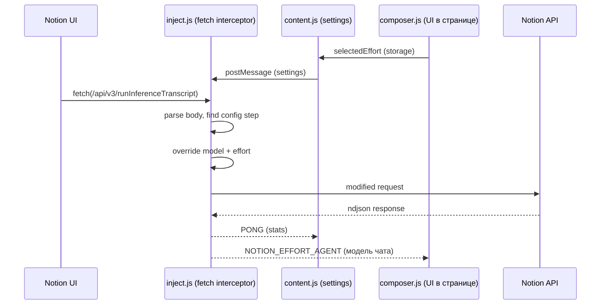

<div align="center">

#  Notion Effort

**Chrome extension для управления AI-моделью и уровнем reasoning в Notion**  
*Перехватывает запросы к Notion AI и подменяет модель/усилие на нужные*

<p align="center">
  
  
  
  
  
</p>

</div>

---

##  Возможности

| | Функция | Описание |
|---|---------|----------|
|  | **Перехват запросов** | Перехватывает `POST /api/v3/runInferenceTranscript` и модифицирует payload |
|  | **4 уровня усилий** | Low → Medium → High → Max, с понижением до потолка модели |
|  | **Статистика** | Счётчик перехваченных и изменённых запросов в реальном времени |
|  | **Минималистичный UI** | Тёмная тема, пикер усилия у поля ввода и в попапе |
|  | **Статус** | Индикатор активности — зелёный если interceptor работает |

---

##  Установка

1. Скачай или клонируй репозиторий:

```bash
git clone https://github.com/lucudar/notion-effort.git
```

2. Открой `chrome://extensions/`
3. Включи **Developer mode** (верхний правый угол)
4. Нажми **Load unpacked**
5. Выбери папку `notion-effort` (корень репозитория)

> [!TIP]
> После обновления кода нажми кнопку 🔄 на карточке расширения в `chrome://extensions/`

---

##  Использование

1. Открой [app.notion.com](https://app.notion.com)
2. **Модель выбери в настройках самого Notion** — расширение её не трогает
3. Уровень усилия выбери пилюлей у поля ввода или в попапе расширения
4. Отправляй AI-запросы — расширение подставит усилие в payload

> [!IMPORTANT]
> Выбора модели в расширении больше нет. Сервер игнорировал подменённую модель и
> брал её из воркспейс-настроек, поэтому пикер моделей был контролом, который
> ничего не делает. Подробности — в разделе про allowlist ниже.

---

##  Модели

| Alias | Название | Семейство | Усилия |
|-------|----------|-----------|--------|
| `almond-croissant-low` | Sonnet 4.6 | Anthropic | low / medium / high / max |
| `angel-cake-high` | Sonnet 5 | Anthropic | high |
| `avocado-froyo-medium` | Opus 4.6 | Anthropic | medium |
| `apricot-sorbet-high` | Opus 4.7 | Anthropic | high |
| `ambrosia-tart-high` | Opus 4.8 | Anthropic | low / medium / high / max |
| `acai-budino-high` | Fable 5 | Anthropic | high (🔒 restricted) |
| `agave-flan` | Opus 5 | Anthropic | low / medium / high / max |
| `albuquerque-quinn` | Opus 5.5 | Anthropic | low / medium / high / max |
| `assam-chai` | Fable 5.1 | Anthropic | — (restricted) |
| `onico` / `orlando-quinn` / `omodi` | GPT-6 Sol / Astra / Luna | OpenAI | low / medium / high / max |
| `soursop-shortcake` | Grok 4.6 | xAI | — |
| `orange-mousse` | GPT-5.6 Sol | OpenAI | medium / high |
| `orchid-muffin` | GPT-5.6 Terra | OpenAI | medium / high |
| `olive-jellyroll` | GPT-5.6 Luna | OpenAI | medium / high |
| `oatmeal-cookie` | GPT-5.2 | OpenAI | medium / high |
| `oval-kumquat-medium` | GPT-5.4 | OpenAI | medium / high |
| `opal-quince-medium` | GPT-5.5 | OpenAI | medium / high |
| `vertex-gemini-3.5-flash` | Gemini 3.5 Flash | Gemini | low / medium / high |
| `galette-medium-thinking` | Gemini 3.1 Pro | Gemini | low / medium |
| `xigua-mochi-medium` | Grok 4.3 | xAI | low / medium / high |
| `strawberry-whoopiepie` | Grok 4.5 | xAI | low / medium / high |
| `fireworks-kimi-k2.6` | Kimi K2.6 | Mystery | — |
| `fireworks-kimi-k2.7` | Kimi K2.7 Code | Mystery | — |
| `fireworks-kimi-k3` | Kimi K3 | Mystery | low / high / max |
| `baseten-deepseek-v4-pro` | DeepSeek V4 Pro | Mystery | low / medium / high / max |
| `baseten-glm-5.2` | GLM 5.2 | Mystery | high / max |

---

##  Архитектура



**Как работает:**
1. `inject.js` переопределяет `window.fetch` в контексте страницы
2. При запросе к `/api/v3/runInferenceTranscript` парсит body
3. Находит `transcript[0].value.model` и подменяет на выбранную модель
4. Отправляет модифицированный запрос в Notion API

---

##  Технологии

| Категория | Технология |
|-----------|-----------|
| Платформа | Chrome Extension Manifest V3 |
| Перехват | Fetch API override (page context) |
| UI | Vanilla HTML/CSS/JS, тёмная тема |
| Хранение | chrome.storage.local |

---

##  Структура проекта

```
notion-effort/
├── manifest.json          # Manifest V3 конфигурация
├── unlock.js              # Statsig gate unlocker (MAIN world, document_start)
├── console-snippet.js     # Тот же анлок + диагностика для вставки в DevTools
├── inject.js              # Fetch interceptor (page context)
├── content.js             # Content script — мост между storage и inject
├── models.js              # Каталог моделей для пикера
├── composer.js            # Панель у поля ввода: модель чата + effort (единственный UI)
├── background.js          # Service worker — хранение статистики
├── icons/
│   ├── icon16.png
│   ├── icon48.png
│   └── icon128.png
├── desktop/               # версия для Notion.exe на ПК (см. desktop/README.md)
└── README.md
```

Версия для Notion на ПК живёт в папке `desktop` (см. её README). Она берёт скрипты отсюда как есть, поэтому правки расширения работают и там.

---

##  Возврат пикера моделей на Business Trial

Notion прячет пикер под Statsig-гейтом **`hide_model_selector_for_business_trials`**.
Хеш подтверждён: `djb2("hide_model_selector_for_business_trials") === "1783351065"`,
`sha256-b64 === "+f9XJ7RxxUMW/CJQ1ucruGNt9b9j+vp4yMdaMiQT3xI="`.

**Почему старый сниппет перестал работать:** ключ `STATSIG_LOCAL_STORAGE_INTERNAL_STORE_OVERRIDES_V3`
читает только легаси-SDK `statsig-js`. Современный `@statsig/js-client` хранит оверра��ды
**в памяти** (`LocalOverrideAdapter`), а значения гейтов берёт из bootstrap-блоба на странице
или из кэша `statsig.cached.evaluations.*`. Запись в localStorage такой клиент просто игнорирует.

`unlock.js` патчит **все** каналы, по которым значение гейта может приехать, и стартует
в `world: "MAIN"` на `document_start` — до бандла Notion:

| # | Канал | Что делает |
|---|-------|-----------|
| 1 | `localStorage` | сидит оверрайды в 3 ключа + перехватывает `getItem`, чинит кэш `statsig.cached.evaluations.*` |
| 2 | `JSON.parse` | ловит bootstrap-блоб, инлайненный в HTML |
| 3 | `fetch` / `XHR` | переписывает `feature_gates` в ответах `/v1/initialize`, statsig-CDN и Notion-проксей |
| 4 | Живой клиент | `overrideAdapter.overrideGate()` + обёртка `checkGate` / `getFeatureGate` |

Совпадение ищется по **сыро��у имени, djb2 и sha256-base64** одновременно, так что
хеширование гейтов на стороне Notion роли не играет.

### Гейты сняты, а пикера нет — что дальше

Если `scan()` показывает все гейты в `false` (`client: 32`, `gateValues` сплошь `false`),
значит **Statsig больше не решает**: Notion дополнительно прячет пикер по состоянию подписки.
На Free-плане маркеров триала нет — и все модели доступны; на Business Trial они появляются.

Поэтому `unlock.js` ещё и переписывает ответы Notion API (`/api/v3/*`, только `application/json`):

Имена полей ниже — **реальные**, снятые с живого Notion через `why()`, а не предполагаемые:

| Поле | Было → стало |
|------|--------------|
| `modelSelectionRestricted` | `true` → `false` (флаг, схлопывающий пикер до `Auto`) |
| весь контейнер `trial-v0` | bool → `false`, числа → `0`, строки → `''` |
| `is_biz_trial` | `true` → `false` |
| `days_until_trial_end` | `28` → `0` |
| `trial_tier` | `"business"` → `''` |
| `trial_start`, `trial_end` | дата → `null` / `''` |
| `subscription_tier` | `business_trial` → `business` (голое `trial` → `free`) |
| `plan_type`, `pending_plan_type` | `business_trial` → `business` |
| `spaceSubscriptionTier`, `planType` | `business_trial` → `business` |
| `hideModelSelector`, `shouldHideModelSelector` | → `false` |
| `canSelectModel`, `showModelSelector`, `allowModelSelection` | → `true` |

Затронутые эндпоинты: `getLifecycleUserProfile`, `getSpacesFanout`, `getAppConfig`,
`getSubscriptionData`, `getPublicSpaceData`, `getUserHomePages`, `getCustomerOffersReceived`,
`getInferenceTranscriptsForUser`.

> [!IMPORTANT]
> Стриминг не буферизуется: `runInferenceTranscript`, `subscribe`, `ping` и прочие
> long-poll / SSE-эндпоинты в skip-листе, плюс стоит проверка `content-type`.
> Иначе ответ AI завис бы до конца стрима.

### Свой пикер вместо нативного

Даже со снятыми гейтами нативный пикер остаётся пустым: каталог моделей приходит
с сервера, и на этом плане он пустой — рендерить нечего. Поэтому `composer.js`
рисует собственный пикер прямо в странице.

- Каталог локальный — `models.js`, один список на попап и на пикер, разъехаться не могут.
- Пилюля крепится **геометрически**: ищем видимый `[contenteditable][role="textbox"]`
  и встаём над его правым краем. Классы Notion не используются, поэтому редизайн
  композера её не сломает; если поля нет — уходим в правый нижний угол.
- UI живёт в Shadow DOM, так что стили Notion до него не достают.

Пикер показывает не намерение, а факт. `inject.js` после подмены шлёт
`NOTION_EFFORT_APPLIED` с моделью, которая **реально ушла в запросе**, и статусом
ответа сервера:

Дальше `inject.js` читает **копию** ответа (оригинал уходит странице нетронутым)
и ищет в нём поле, которым сервер называет модель. Отсюда честное разделение:
HTTP 200 — это «запрос принят», а не «запустился Opus 5».

| Состояние | Что видно | Что это значит |
|-----------|-----------|----------------|
| `pending` | `Sending Opus 5…` | запрос ушёл |
| `unverified` | жёлтая рамка + `Sent as Opus 5 — not confirmed` | принято, но сервер модель не назвал — **доказательств нет** |
| `verified` | зелёная рамка + `Confirmed by server: Opus 5` | сервер сам подтвердил модель |
| `mismatch` | красная рамка + `Server ran Haiku 4.5, not Opus 5` | тихая подмена на другую модель |
| `observed` | серая рамка + `No swap — server ran X` | подмены не было, просто видим выбор сервера |
| `error` | красная рамка + `Rejected: Opus 5 (403)` | сервер отказал |

### Надёжный путь: workspace allowlist

Клиентская подмена — самый слабый рычаг: сервер вправе её проигнорировать.
Сильнее — **Settings → Notion AI → Model controls → Allowed models**: это
серверный список, и `Auto` обязан его уважать. Если оставить там одну модель,
выбор происходит на сервере, и расширение для выбора модели не нужно вовсе.

Проверяется это в режиме `Auto` (пикер стоит в стороне и ничего не подменяет):
статус `observed` покажет, какую модель сервер выбрал сам. Если это нужная
модель — задача решена без подмены, и за расширением остаются только усилие и
`maxIntelligence`.

Зелёный цвет зарезервирован только за `verified`. Если Notion в ответе модель не
возвращает, честный потолок — жёл������ый `not confirmed`.

**Почему вердикт консервативный.** Формат ответа не документирован, поэтому наивный
поиск «первого поля со словом model» ловит ложные срабатывания: каталог доступных
моделей (`availableModels[...]`, `modelOptions`) или настройку аккаунта
(`userSettings.defaultModel`) легко принять за факт прогона. Такие ключи и всё,
что лежит под ними, из доказательств исключены; неизвестные строки и два
конфликтующих ID тоже дают `unverified`. Обвинение в подмене выносится только
при одном однозначном известном ID — ложный `mismatch` хуже честного «не знаю».

Вердикт можно перепроверить руками — в консоли на `app.notion.com`:

```js
__notionEffortDebug.verdict      // итог
__notionEffortDebug.candidates   // что нашли в ответе и по каким путям
__notionEffortDebug.raw          // сырой ответ, если нужно копать

__notionEffortDebug.request.modelFields  // все поля модели в запросе
__notionEffortDebug.request.stale        // те, что ушли НЕ с нашей модел��ю
```

`request.stale` отвечает на ключевой вопрос при `mismatch`: сервер проигнорировал
нашу модель — или мы правим не то поле. Пусто — значит запрос был корректным и
решение принято на сервере.

### Усилие проверяется отдельно

Сервер может уважить модель и молча выбросить `reasoningEffort`, поэтому
подтверждение модели на усилие не распространяется. В подписи усилие называется
только когда ответ его вернул: `Confirmed by server: Opus 5 · max`. Если ответ
про усилие промолчал — будет `max?` с вопросительным знаком.

```js
__notionEffortDebug.effortVerdict      // verified | mismatch | unverified
__notionEffortDebug.effortCandidates   // что нашли в ответе
__notionEffortDebug.request.effortFields   // что реально ушло
__notionEffortDebug.request.effortInModelId // усилие, зашитое в ID модели
```

Важная гипотеза про `effortInModelId`: у части моделей усилие закодировано прямо
в идентификаторе (`ambrosia-tart-high`, `oval-kumquat-medium`,
`almond-croissant-low`). Если так, то настоящий рычаг — ID, а `reasoningEffort`
декоративен, и менять усилие отдельно от модели невозможно.

**Замер показал:** ответ про усилие не говорит вообще — `effortCandidates` пуст,
хотя модель в том же ответе названа. Значит `verified` для усилия недостижим в
принципе, и честный потолок — `max (unconfirmed)`. Зелёного для усилия не будет.

Остаётся косвенная проверка — **парность с входящим запросом**. Перед патчем
сохраняется снимок того, что прислал сам Notion, так что сравнение доступно
всегда, а не только в `Auto`:

```js
__notionEffortDebug.incoming.effortFields  // что шлёт сам Notion
__notionEffortDebug.request.effortFields   // что шлём мы
```

Совпадение путей — максимум доступной уверенности: мы пишем в то же поле, что и
родной интерфейс. Подтвердить, что сервер усилие исполнил, нельзя ничем.

### Потолок модели

Не каждая модель поддерживает все четыре уровня. Просить `max` у модели, которая
его не знает, — риск отклонённого запроса, поэтому усилие понижается до потолка
этой модели, а подпись показывает подмену честно: `max → high (model limit)`.
Если модель не поддерживает усилие вовсе, поле не отправляется.

### Диагностика

В консоли на `app.notion.com`:

```js
__notionUnlock.scan()                          // где лежит гейт + что уже пропатчено
__notionUnlock.why()                           // таблица: какие эндпоинты несут trial/plan/model поля
__notionUnlock.dump('getLifecycleUserProfile') // значения ДО патча (исходный ответ)
__notionUnlock.verify('getLifecycleUserProfile') // значения ПОСЛЕ патча — что реально увидел Notion
__notionUnlock.models()                        // где лежит спи��ок моделей и какой он длины
__notionUnlock.setModels()                     // ЭКСПЕРИМЕНТ: залить модели в пустой массив
__notionUnlock.setModels(false)                // выключить заливку
__notionUnlock.stats                           // счётчики по к��налам
__notionUnlock.hash('any_gate_name')           // raw / djb2 / sha256
__notionUnlock.addGate('new_gate_name', false) // добавить гейт и перезагрузить
__notionUnlock.setPlanPatch(false)             // выключить переписывание подписки
__notionUnlock.setTier('free')                 // форсить конкретный тариф вместо strip
__notionUnlock.setTier('strip')                // вернуть режим по умолчанию
```

`stats.plan` — сколько полей подписки реально переписано. Если там `0`,
патч не нашёл ни одного поля, и правки в `FORCE_FALSE` / `TIER_KEY` не применяются.
Каждая подмена пишется в `stats.hits` в виде `plan:is_biz_trial:true→false`.

Порядок действий, если пикер всё ещё скрыт:

1. Перезагрузи страницу, открой AI-композер — рекордер наполняется на живых запросах.
2. `__notionUnlock.why()` — покажет эндпоинты и найденные в них поля вроде
   `isTrialing`, `subscriptionTier`, `plan_type`.
3. `__notionUnlock.dump('<фрагмент эндпоинта>')` — выведет пути и **значения** этих полей.
4. Скинь вывод — по нему видно точное имя поля, которое надо добавить в `FORCE_FALSE` / `FORCE_TRUE`.

Если `scan()` показывает `hits: []`, гейт прилетает под другим именем —
найди в Network ответ `initialize`, возьми имя/хеш и добавь через `__notionUnlock.addGate(...)`.

> [!NOTE]
> Даже если пикер не вернулся, **выбор модели всё равно работает**: `inject.js` подменяет
> `transcript[].value.model` прямо в запросе `/api/v3/runInferenceTranscript`, так что попап
> расширения полностью заменяет собой UI-пикер.

`console-snippet.js` — версия без расширения: вставляется в DevTools, печатает диагностику
и патчит живой клиент (работает до перезагрузки страницы).

### Новый чат Notion (agent service) и проверка модели

Новый чат (`app.notion.com/chat?t=…`) шлёт `createAgentThread` /
`sendEventToAgentThread` — **в этих запросах нет ни модели, ни effort**.
Сервер назначает их сам по политике воркспейса и сохраняет в записи треда:
`thread.data.agent_provider = { model, modelSelection, reasoningEffort }`.

`inject.js` читает эту запись из ответов `syncRecordValues*`,
`createAgentThread`, `getInferenceTranscriptsForUser` и показывает в футере
пикера реальную модель и effort открытого треда, например
`Opus 5.5 (Auto) · effort HIGH · MAX not applied`. В консоли:
`__notionEffortAgent`.

**Effort чата:** настройка `space_view.settings.personal_agent_model_preference`
на триале сервером игнорируется (с `{albuquerque-quinn, max}` треды всё равно
`auto / medium`). С 2.1 расширение пишет effort прямо в запись треда
`thread.data.agent_provider.reasoningEffort` (`update` через
`saveTransactionsFanout`): после `createAgentThread` и перед
`sendEventToAgentThread`, затем перечитывает тред (`syncRecordValues`).
В панели: `MAX active in this chat`, `Written, but server reset to …` или
`Effort write failed`. Статус записи: `__notionEffortAgentPref`, всё сразу:
`copy(__notionEffortAgentDiag())`.

**Пикер моделей (2.2):** в панели список Model — Auto и модели с `picker: true` в `models.js`
(Fable 5 / 5.1 и GPT-6 Astra на триале `trial_not_allowed`, скрыты). Выбранная модель
пишется в тот же `thread.data.agent_provider` (`model` + `modelSelection: "manual"`;
если сервер отклоняет — повтор без `modelSelection`). В новом чате первое сообщение
уходит ещё с моделью Auto — запись делается после `createAgentThread`.

**2.4 (итог на триале):** `modelSelection: "manual"` сервер принимает, но на следующем
сообщении пишет «Changed model to Auto» и сбрасывает тред на auto / medium. С `auto`
поле `model` — результат маршрутизации Auto на каждое сообщение, запись в него бесполезна;
effort при этом сохраняется.

**2.7 (модель через Allowed models):** в тред пишется только effort. Модель задаётся
настройкой Settings → Notion AI → Model controls → «Allowed models for Notion Agent»,
а Auto её учитывает, в том числе на триале. Настройка хранится в
`space.settings.personal_agent_model_policy`:
`{ disabledModels, disabledProviders, allowedRestrictedModels }`.

- Выбор модели X в панели отправляет `POST /api/v3/updateSpaceSettings`
  `{ spaceId, settingsPatch: { personal_agent_model_policy }, unsetSettingKeys: [] }`.
  В `disabledModels` попадают все модели из `getAvailableModels`
  (`surface: "workspace_model_settings"`), кроме X. Провайдер X убирается из
  `disabledProviders` (например, `xai` для Grok). В `allowedRestrictedModels` остаётся только X, если она ограниченная, иначе список пуст: сервер не принимает модель, которая одновременно отключена и разрешена (ValidationError).
- 2.10: политика пишется только в пространство, где отправляется сообщение чата (spaceId из тела отправки). Бэкапы других пространств (2.9 по ошибке писала в чужое) откатываются автоматически при следующей отправке. Пустые списки при сравнении не учитываются (сервер их не хранит). После ошибки запись не повторяется до следующего выбора.
- 2.11: в пикере все модели каталога пространства (getAvailableModels), сгруппированные по провайдеру; скрыты только недоступные на триале Fable 5, Fable 5.1 и GPT-6 Astra. Модели, которых нет в models.js, получают имя из ответа сервера.
- 2.12: удобное меню. Effort — ряд кнопок Auto/Low/Medium/High/Max сверху (неподдерживаемые выбранной моделью приглушены, берётся ближайший ниже). Список моделей прокручивается отдельно, есть поиск (Enter выбирает первую), у каждой модели диапазон effort. Исправлено: overflow:hidden отменял прокрутку, и effort уходил за экран.
- 2.13: ПК-версия — новые вкладки (новый чат) больше не зависают пустыми: вкладка, приостановленная до регистрации скрипта, не отвечала на Page.enable, и скрипт ждал его вечно. Имена моделей из каталога берутся из modelMessage. diag.json больше не кодируется дважды. Список моделей в другом пространстве возвращается только когда этот аккаунт им пользуется (раньше попытка вернуть его в недоступном пространстве давала 403 и ошибку «Model not set» при рабочей модели); 403 объясняется словами (менять настройки пространства может только владелец).
- 2.14: effort для каждой модели берётся из каталога пространства (supportedReasoningEfforts). Max на модели без max (Grok 4.6: до XHigh) отправляется как ближайший ниже (xhigh), а не как неподдерживаемый max — с ним Notion отбрасывал выбор и отвечал моделью по умолчанию (GPT-5.6 Sol). Opt-in модели определяются по restrictedAccessModelsInPickerConfig: restrictedForPersonalAgent true и у всех моделей, выключенных политикой.
- 2.15: кнопка Log внизу панели — пошаговый журнал: выбор, что политика пространства разрешает сейчас, запись политики, ожидание перед отправкой, запись effort, какую модель реально запустил сервер и, если не ту, почему (политика в этот момент, флаги модели в каталоге, есть ли она в списке моделей чата). Copy копирует журнал. Перед каждой отправкой политика перечитывается с сервера (её мог переписать Notion на ПК или другой профиль). Журнал без текста сообщений и данных аккаунта; он же в diag (trace).
- 2.16: журнал точнее. why читает каталог заново (раньше брался снятый при старой политике, и «restricted for Notion Agent» было ложным следом), пишет, что каталог разрешает агенту сейчас, есть ли запущенная модель в каталоге (если нет — это запасной вариант сервера) и сколько мс прошло между записью политики и отправкой. Строка body — какие поля модели/effort Notion сам кладёт в отправку (без текста).
- 2.17: строка stream в журнале — что сервер пишет в ответе об отправке: модель, запасной вариант, лимиты, ошибки (только короткие значения под такими ключами, без текста ответа).
- 2.18: пробный режим «модель в чат». Auto сервера игнорирует политику, поэтому модель пробуется назвать на самом чате, по одному способу на отправку: body (поля model/modelSelection/reasoningEffort в самой отправке, повтор без них при отказе), auto (модель в записи чата, selection auto), manual (то же с selection manual). Сработавший способ запоминается, строки model в журнале показывают каждый шаг; кнопка Retry ways начинает заново.
- 2.19: каталог при 403 перечитывается без заголовков чужого аккаунта; неудачный способ «модель в чат» пишется в журнал один раз.
- 2.20: вкладка Chat: по каждому сообщению какая модель реально ответила, что в этот момент разрешал список пространства и входит ли модель в него. Флажок Watch only: расширение ничего не меняет (ни список, ни чат, ни effort), чтобы проверять модель, выбранную вручную в настройках Notion.
- 2.21: вкладка Chat читает список пространства уже после записи политики (раньше могла показать предыдущий) и показывает имена моделей из пикера (orange-mousse → GPT-5.6 Sol).
- 2.22: политика выключает не только модели, но и всех остальных провайдеров, как это делает страница Model controls. Запасная модель Auto (orange-mousse, openai) отсутствует в каталоге, поэтому её можно отключить только вместе с провайдером. Для моделей OpenAI запасная модель остаётся того же провайдера.
- 2.23: при выборе модели OpenAI запасная модель Auto (orange-mousse, GPT-5.6 Sol) дополнительно выключается по имени. Если сервер такой id не принимает, политика пишется без него, и журнал сообщает об этом.
- 2.24: убран пробный режим «модель в чат» (способы body, auto, manual) и кнопка Retry ways: ни один из них не сработал. Модель выбирается только через политику пространства.
- Исходная политика сохраняется в `localStorage.notionEffortPolicyBackup`. Выбор
  Auto возвращает её.
- Политика ставится перед каждой отправкой сообщения и сразу при выборе модели.
- Действует на всё пространство. `custom_agent_model_policy` не меняется.
- Диагностика: поля `policy`, `policyLog`, `policyBackup`, `catalogue` в
  `copy(__notionEffortAgentDiag())`.

Кодовые имена новых моделей также подхватываются на лету из
`getAvailableModels` (`modelMessage`, `modelConfiguration.supportedReasoningEfforts`)
и `zeroRetentionModels`: `__notionUnlock.catalogue`.

С 1.8 popup убран, весь UI — панель у поля ввода (кнопка с именем модели и effort).
Сверху в ней блок «Model in this chat (from Notion server)»: имя модели,
`(Auto)`, кодовое имя и effort — прямо из `thread.data.agent_provider`,
который возвращает сервер Notion.

Производительность: запросы агента (`listenToThreadTranscript`, `*AgentThread`,
`*AgentService` и т.п.) и ndjson/event-stream ответы проходят без буферизации,
иначе ответ ИИ задерживается до конца стрима.

Диагностика: `probe.js` (пишет все каналы fetch/XHR/WS/Workers) с 1.7 не
подключён — он замедлял Notion. Для отладки верните его в `manifest.json`
(`content_scripts` MAIN перед `unlock.js`) и используйте
`copy(__notionEffortReport())` / `copy(__notionEffortReport(/shape/))`.

---

##  Troubleshooting

| Проблема | Решение |
|----------|---------|
| **Расшир��ние не активно** | Обнови страницу Notion после установки расширения |
| **Модель не меняется** | Открой DevTools → Console, проверь есть ли логи `[Notion Effort]` |
| **Нет иконки** | Перезагрузи расширен��е в `chrome://extensions/` |
| **Запросы не перехватываются** | Убедись что ты на `app.notion.com`, а не на другом домене |

---

##  Contributing

PR и issue приветствуются!

```bash
git clone https://github.com/lucudar/notion-effort.git
cd notion-effort
# Внеси изменения
# Загрузи в chrome://extensions/ как unpacked для теста
```

---

##  Disclaimer

> [!WARNING]
> Это **неофициальный** инструмент. Notion не одобряет модификацию запросов.
>
> - Используй на свой страх и риск
> - Расширение не отправляет данные на сторонние серверы
> - Все настройки хранятся локально в браузере

---

<div align="center">

**MIT License** © 2026

</div>
